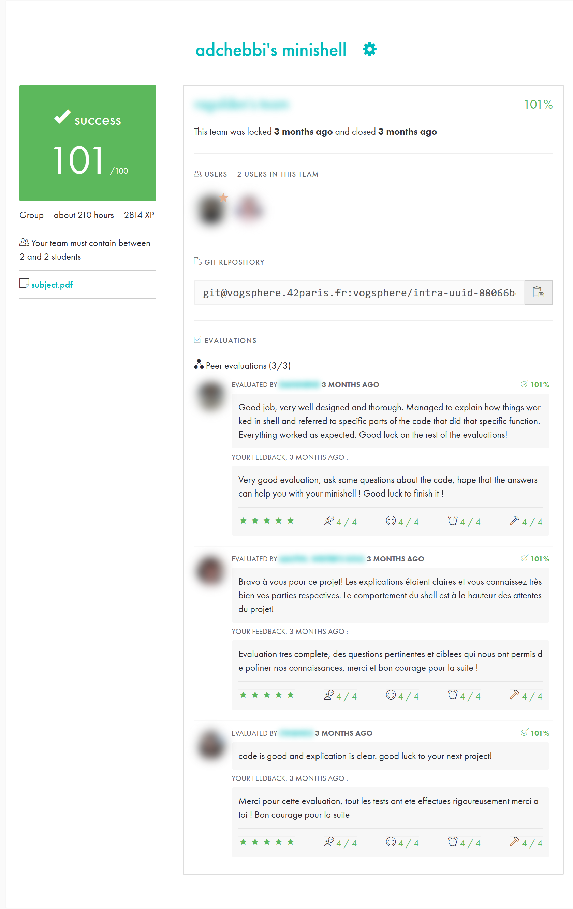

*This project has been created as part of the 42 curriculum by ragolden, adchebbi.*

# minishell

> A Bash-like interactive shell written from scratch in C: lexer, parser, variable expansion, pipelines,
> redirections, heredocs and signal handling, all built on raw Unix system calls.

   

```console
minishell$ cat << EOF | grep hello
> hello world
> bye
> EOF
hello world
minishell$ unset PATH
minishell$ ls
minishell: ls: command not found
minishell$ echo "status=$?"
status=127
```

## Highlights

- **Full command-line pipeline**: tokenizer → syntax check → `$VAR` / `$?` expansion → quote removal → parser → executor.
- **Processes and file descriptors**: multi-stage pipelines with `fork`, `execve`, `pipe`, `dup2` and `waitpid`;
  every unused fd is closed in each child.
- **Heredocs done right**: several heredocs on one command (`cat << A << B`), quoted delimiters disable
  expansion (`<< 'EOF'`), heredocs inside pipelines.
- **Bash-accurate signals and exit codes**: `Ctrl-C`, `Ctrl-D` and `Ctrl-\` behave like Bash at the prompt, during
  execution and inside heredocs; exit codes 126, 127, 130, and 2 for syntax errors.
- **Terminal control**: `termios` (`VQUIT`, `ECHOCTL`) to stop `^\` from being echoed while a heredoc is read.
- **Memory**: no leaks from project code under Valgrind (readline's own allocations are suppressed with `readline.supp`).

## Features

| Area | Supported |
|---|---|
| Prompt | Interactive prompt with history (`readline`) |
| Built-ins | `echo` (with `-n`), `cd`, `pwd`, `export`, `unset`, `env`, `exit` |
| Quotes | `'single'` (literal) and `"double"` (with expansion) |
| Expansion | `$VAR`, `$?` |
| Redirections | `<`, `>`, `>>`, `<<` (heredoc) |
| Pipes | Any number of commands: `cmd1 \| cmd2 \| cmd3` |
| Signals | `Ctrl-C`, `Ctrl-D`, `Ctrl-\` in every context |

Not implemented (bonus part of the subject): `&&`, `||`, parentheses and `*` wildcards. `;` and `\` are not
interpreted, as required by the subject.

## Build & Run

Requirements: `cc` (or `gcc` / `clang`), GNU Make and the readline library (`sudo apt install libreadline-dev`).

```bash
make
./minishell
```

Other targets: `make clean`, `make fclean`, `make re`.

## How it works

```
readline("minishell$ ")
  └─ check_unclosed_quotes      reject  echo "abc   (exit status 2)
  └─ add_spaces_ops + ms_split  "ls|wc" -> ["ls", "|", "wc"], quote-aware
  └─ lexer                      words, pipes and redirection tokens
  └─ check_tokens_syntax        "| ls", "ls >"... -> syntax error (exit status 2)
  └─ expander                   $VAR and $? (not inside single quotes)
  └─ quote_removal
  └─ parse                      list of commands, each with argv and redirections
  └─ exec_cmds
       ├─ heredocs              all read before any fork (Ctrl-C aborts the whole line, status 130)
       ├─ single built-in       runs in the parent process (so cd, export and exit affect the shell)
       └─ otherwise             one fork per command, pipes between them
```

The shell uses one global variable, `g_status`, written only by the signal handlers. That is the only
safe way to report a `Ctrl-C` back to the main loop.

## Testing

- Compared output and exit status with `bash --posix` on quotes, expansion, redirections, pipelines, heredocs,
  `unset PATH`, unknown commands and syntax errors.
- Ran the shell under Valgrind with `--suppressions=readline.supp` and `--trace-children=yes`.

```bash
valgrind --leak-check=full --show-leak-kinds=all --trace-children=yes --suppressions=readline.supp ./minishell
```

## Project structure

```
.
├── Makefile
├── readline.supp        # Valgrind suppressions for readline's internal allocations
├── inc/                 # headers
├── libft/               # personal C library (strings, memory, ft_printf, get_next_line)
└── srcs/
    ├── main/            # read-eval loop
    ├── lexer/           # tokenizer, quote removal
    ├── parser/          # syntax check, command list building
    ├── expander/        # $VAR and $? expansion
    ├── exec/            # fork/execve, pipes, redirections, heredocs, PATH lookup
    ├── builtins/        # echo, cd, pwd, export, unset, env, exit
    ├── env/             # environment as a linked list
    ├── signals/         # prompt / child / heredoc signal handling
    └── utils/
```

## Resources

- [GNU Bash Reference Manual](https://www.gnu.org/software/bash/manual/bash.html), the reference used to align behavior
- [POSIX Shell Command Language](https://pubs.opengroup.org/onlinepubs/9699919799/utilities/V3_chap02.html)
- [The Linux Programming Interface](https://man7.org/tlpi/) by M. Kerrisk: processes (ch. 24–27), pipes (ch. 44), signals (ch. 63)
- [The TTY demystified](https://www.linusakesson.net/programming/tty/), which explains why `SIG_IGN` alone does not hide `^\`
- [GNU Readline API](https://tiswww.case.edu/php/chet/readline/readline.html#SEC23): `rl_on_new_line`, `rl_replace_line`, `rl_redisplay`
- [Write a Shell in C](https://brennan.io/2015/01/16/write-a-shell-in-c/) by Stephen Brennan
- Linux man pages: `fork`, `execve`, `pipe`, `dup2`, `waitpid`, `sigaction`, `tcsetattr`

### AI usage

AI assistance (Claude, Anthropic) was used for:

- **Debugging**: finding the root cause of a double-heredoc bug. `dup2` was called on `STDIN_FILENO` between
  heredoc reads, which corrupted the saved stdin of later `handle_heredoc` calls. The fix was to resolve every
  file descriptor in `apply_redirs` before applying any `dup2`.
- **Signals and terminal**: understanding why `Ctrl-\` still printed `^\` during heredoc input with `SIGQUIT`
  ignored. The cause is `ECHOCTL` at the tty driver level, fixed with `tcsetattr` / `VQUIT` / `_POSIX_VDISABLE`.

## 42 evaluation

Validated at **101/100** by 3 peer evaluations (team of 2).
Other students' names and photos are blurred.

<p align="center"></p>

## Authors

- **Raphael Goldenberg** ([@raphaelggg](https://github.com/raphaelggg)), 42 login `ragolden`
- **Adem Chebbi** ([@ademchbb](https://github.com/ademchbb)), 42 login `adchebbi`
